# Mapi Next-Gen Architecture & Implementation Plan

## 1. Executive Summary & Goals

This specification consolidates the architectural decisions, empirical discoveries, performance benchmarks, and additive operations designed for `mapi`.

### Core Goals:
1. **Ultra-Low Latency Overhead**: Maintain $\sim 30\ \mu\text{s}$ per call client overhead.
2. **Minimal Memory Footprint (< 10 MB RAM)**: Efficiently handle 50+ companies with large OpenAPI specs (500–750 MB raw JSON/YAML) without decoding monolithic structures into the Python heap.
3. **Packfile & Granular Operation Storage**: Store pre-compiled, Zstandard-compressed MessagePack operations in a single bundleable SQLite B-Tree packfile or loose filesystem fallback, decoding only single operations ($2.02\ \mu\text{s}$, $\sim 200\text{ bytes}$) on demand.
4. **Adaptive `HotOpCache`**: Rank and retain frequently accessed operations in memory ($< 0.05\ \mu\text{s}$ hit time), evicting cold endpoints gracefully.
5. **Zero Breaking Changes**: 100% backward compatibility for all existing client signatures (`client.<provider>.<api>()`, `execute()`, `aexecute()`, `abatch()`, `discovery.*`, `__init__()`).
6. **Dynamic Spec Lifecycle**: Support dynamic runtime spec registration (`register_spec` with auto-inferred provider), upstream diff checking (`check_spec_diff` with `SpecUpdateAvailableWarning`), and atomic in-place updates (`update_spec`).
7. **Developer & AI Ergonomics**: First-class support for `_dry_run`, `to_curl()`, `_idempotent`, `_stream`, auto-pagination (`paginate` / `apaginate`), and LLM tool calling (`to_tool()` / `call_tool()`).

---

## 2. Empirical Discoveries & Benchmarks

| Metric | Monolithic Service Decode | Granular Operation Decode | Impact |
| :--- | :--- | :--- | :--- |
| **Decode Latency** | $353.49\ \mu\text{s}$ | **$2.02\ \mu\text{s}$** | **175x faster** |
| **Heap Allocation** | $\sim 2.0\text{ MB}$ (500 ops) | **$\sim 200\text{ bytes}$** (1 op) | **99.99% less RAM** |
| **50 Companies (Raw Specs)** | $500\text{--}750\text{ MB}$ JSON | **$12\text{--}18\text{ MB}$** `msgpack.zst` | **97.6% disk reduction** |
| **Packfile Point Lookup** | $20\text{--}50\text{ \mu s}$ (directory inode) | **$1.02\ \mu\text{s}$** (SQLite B-Tree) | **20x–50x faster** |

### Key Takeaways:
1. **Never Decode Monolithic Specs at Runtime**: Loading all 500 operations of a provider into memory wastes CPU and RAM when an application or agent typically executes only 1–5 specific endpoints.
2. **SQLite B-Tree as Default Packfile**: Standard library `sqlite3` with `WITHOUT ROWID` offers microsecond lookups, $0$ external C dependencies, standard wheel packaging, and multi-process read concurrency.
3. **Adaptive Caching**: A bounded, frequency-ranked cache keeps hot endpoints instantaneous while memory usage stays flat regardless of how many APIs are registered.

---

## 3. End-to-End System Flow & Lifecycle

```mermaid
flowchart TD
    subgraph Bootup ["1. Bootup & Initialization (< 1 ms)"]
        Init["client = Mapi()"] --> LoadEng["Open Packfile / DiskLoader"]
        LoadEng --> InitCache["Initialize HotOpCache(maxsize=128)"]
        InitCache --> Ready["Ready (Zero specs parsed in heap)"]
    end

    subgraph Execution ["2. Request Execution (~30 µs overhead)"]
        Req["client.stripe.charges.create(...)"] --> CacheCheck{"HotOpCache hit?"}
        CacheCheck -- Yes --> GetOpFast["Return cached Operation (< 0.05 µs)"]
        CacheCheck -- No --> FetchBTree["Lookup 'op:stripe:REST:charges:create' in B-Tree (1.0 µs)"]
        FetchBTree --> DecodeZst["Decompress msgpack.zst (2.0 µs)"]
        DecodeZst --> InsertCache["Insert into HotOpCache"]
        InsertCache --> GetOpFast
        GetOpFast --> BuildReq["Merge default & custom headers + Resolve URL"]
        BuildReq --> Dispatch{"_dry_run or Wire?"}
        Dispatch -- "_dry_run=True" --> ReturnDry["Return RequestConfig / to_curl()"]
        Dispatch -- Wire --> Transport["Niquests Transport (HTTP/2 / Multiplexed)"]
        Transport --> ReturnResult["Return MapiResult (HeadersDict + Metadata)"]
    end

    subgraph DynamicLifecycle ["3. Dynamic Spec Lifecycle"]
        RegSpec["register_spec(source, provider=None)"] --> InferProv["Auto-infer provider from URL/title"]
        InferProv --> Compile["Compile to granular ServiceData & Operations"]
        Compile --> IngestCache["Register in ServiceCache & Discovery"]
        
        CheckDiff["check_spec_diff(provider)"] --> FetchRemote["Query ETag / SHA-256"]
        FetchRemote --> HasDiff{"Diff found?"}
        HasDiff -- Yes --> WarnUser["Emit SpecUpdateAvailableWarning"]
        HasDiff -- No --> Ok["Spec up to date"]
        
        UpdateSpec["update_spec(provider)"] --> AtomicSwap["In-place atomic pointer swap"]
    end

    subgraph Shutdown ["4. Teardown & Cleanup"]
        Close["client.close() / Context exit"] --> CloseTrans["Close HTTP Sessions"]
        CloseTrans --> CloseDB["Close Packfile Connections"]
        CloseDB --> ClearC["Clear Caches"]
    end
```



---

## 4. Detailed Component Design

### 4.1 Granular Packfile & Storage Engine (`src/mapi/registry/packfile.py`)
- Standard SQLite schema using `WITHOUT ROWID`:
```sql
CREATE TABLE IF NOT EXISTS registry_entries (
    key TEXT PRIMARY KEY,
    payload BLOB NOT NULL
) WITHOUT ROWID;
```
- Keys:
  - `srv:<provider>:<api>:<source>`: Header metadata (`ServiceMetadata`: name, version, servers, format version).
  - `op:<provider>:<api>:<source>:<operation_id>`: Individual serialized `Operation` (zstd-compressed msgpack).
  - `idx:<provider>:<api>:<source>`: List of operation IDs belonging to the service.

### 4.2 Adaptive `HotOpCache` (`src/mapi/cache/hot_cache.py`)
- Bounded thread-safe cache implementing frequency-recency ranking.
- Tracks:
  - `_cache`: `dict[tuple[str, str, str, str], Operation]`
  - `_scores`: `dict[tuple[str, str, str, str], int]`
  - On eviction: Drops the lowest scored entries when `len > maxsize`.

### 4.3 Additive Request Ergonomics
1. **`RequestConfig.to_curl(redact_auth: bool = True) -> str`**:
   Formats an executable `curl` command with escaped quotes, headers, and formatted JSON body. Redacts sensitive authentication tokens by default.
2. **`_dry_run: bool`**:
   When passed to `client.<provider>.<api>.<op>(_dry_run=True)` or `execute(..., _dry_run=True)`:
   - Resolves all path parameters, query parameters, additive default headers, and JSON body.
   - Bypasses network transport completely.
   - Returns a `MapiResult` containing the prepared `RequestConfig` in `.data` with status `"dry_run"`.
3. **`_idempotent: bool`**:
   Automatically generates a UUID v4 string and injects `Idempotency-Key: <uuid4>` into the headers for mutating operations (`POST`, `PUT`, `DELETE`).
4. **`_stream: bool`**:
   Passes `stream=True` to Niquests transport to allow lazy iterator-based streaming of large payloads or SSE streams.
5. **Auto-Pagination (`client.paginate` & `client.apaginate`)**:
   Generator that automatically paginates through results following standard conventions:
   - Cursor-based: `starting_after`, `cursor`, `next_token`
   - Page-based: `page`, `page_number`
   - Offset-based: `offset`, `limit`
   - Header-based: `Link: <url>; rel="next"`

### 4.4 AI Agent & LLM Function Calling (`to_tool` & `call_tool`)
- `client.to_tool(provider, api, operation, source=None) -> dict[str, Any]`:
  Generates a standard OpenAI / Anthropic / Gemini compatible JSON Schema function tool definition:
  ```json
  {
    "type": "function",
    "function": {
      "name": "stripe_REST_charges_create",
      "description": "Create a new charge",
      "parameters": {
        "type": "object",
        "properties": {
          "amount": {"type": "integer", "description": "Amount in cents"},
          "currency": {"type": "string", "description": "3-letter ISO code"}
        },
        "required": ["amount", "currency"]
      }
    }
  }
  ```
- `client.call_tool(tool_name, **arguments) -> MapiResult`:
  Parses `provider_api_operation` and dispatches directly to `execute()`.
- `ApiProxy.to_tool(operation: str)`:
  Exposes tool conversion directly via fluent proxy: `client.stripe.charges.to_tool("create")`.

### 4.5 Dynamic Spec Lifecycle
1. **`register_spec(spec_source, provider=None, api="REST", source="dynamic") -> str`**:
   - `spec_source`: OpenAPI JSON/YAML string, `dict`, or local file path/URL.
   - Optional `provider`: Auto-inferred if `None`:
     - Checks `servers[0].url` (e.g. `https://api.github.com/v3` -> `github`).
     - Fallback to slugified `info.title` (e.g. `Stripe API` -> `stripe`).
     - Fallback to `"dynamic"`.
   - Parses endpoints, resolves schemas, and registers into the active `ServiceCache` and `DiscoveryService`.
2. **`check_spec_diff(provider: str, api: str = "REST") -> SpecDiffResult`**:
   - Compares the currently registered specification hash/operations with the latest or remote specification.
   - Emits `SpecUpdateAvailableWarning` if modifications, additions, or deprecations are detected.
3. **`update_spec(provider: str, api: str = "REST", force: bool = False) -> bool`**:
   - Atomically updates the in-memory registry and cache with the new spec without interrupting active concurrent requests.

---

## 5. Backward Compatibility Matrix

| Interface | Existing Behavior | Next-Gen Behavior | Breaking? |
| :--- | :--- | :--- | :--- |
| `Mapi.__init__(...)` | Initializes client | Accepts optional `packfile_path` & configs | **NO** (additive) |
| `client.execute(...)` | Prepares & sends HTTP | Supports `_dry_run`, `_idempotent`, `_stream` | **NO** (additive) |
| `client.aexecute(...)` | Async HTTP request | Supports `_dry_run`, `_idempotent`, `_stream` | **NO** (additive) |
| `client.abatch(...)` | Concurrent requests | Unchanged | **NO** |
| `client.<provider>.<api>()` | Fluent proxy call | Proxy forwards new kwargs | **NO** |
| `ResponseMetadata` | Captures headers | Adds `.etag`, `.retry_after`, `.rate_limit_*` properties | **NO** (additive) |
| `DiscoveryService` | Queries metadata | In-memory lookup + granular query | **NO** |

---

## 6. Phased Implementation Roadmap

1. **Phase 1: Request Ergonomics & Developer Utilities**
   - Implement `RequestConfig.to_curl()`.
   - Implement `_dry_run`, `_idempotent`, `_stream` in `Mapi.execute()` and `Mapi.aexecute()`.
   - Update `ProxyCaller` and `ApiProxy` to pass through additive flags.
2. **Phase 2: LLM Tool Calling**
   - Implement `to_tool()` and `call_tool()` on `Mapi`.
   - Expose `to_tool()` on `ApiProxy`.
3. **Phase 3: Adaptive `HotOpCache` & Granular Model Support**
   - Implement `HotOpCache` in `src/mapi/cache/hot_cache.py`.
   - Integrate with `Mapi` and `RequestBuilder` for sub-microsecond operation retrieval.
4. **Phase 4: Dynamic Spec Ingestion & Safe Update Lifecycle**
   - Implement `register_spec()`, `check_spec_diff()`, and `update_spec()`.
   - Implement `SpecDiffResult` model and `SpecUpdateAvailableWarning`.
5. **Phase 5: Auto-Pagination**
   - Implement `client.paginate()` and `client.apaginate()`.
6. **Phase 6: Verification & Quality Assurance**
   - Comprehensive unit tests in `tests/unit/test_client.py`, `tests/unit/test_models.py`, `tests/unit/test_hot_cache.py`.
   - Verify 0 lint errors (`ruff check .`), clean formatting (`ruff format --check .`), 0 type errors (`pyright`).
   - Run full test suite (`pytest`) and verify latency benchmarks.
