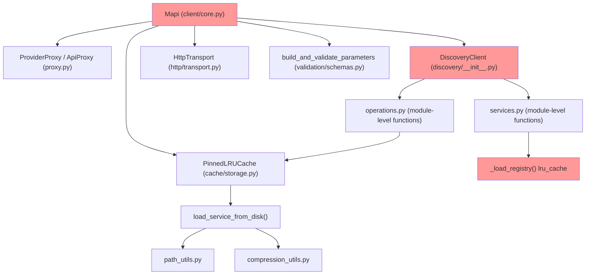
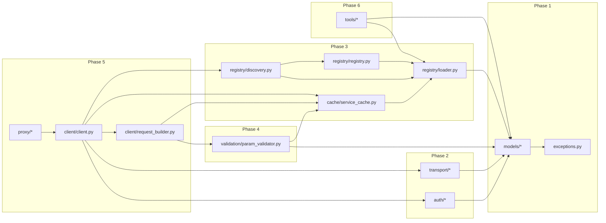

# Mapi Refactor Plan: mapigen → mapi

## Audit Summary

**mapigen** (2,271 LOC across 32 source files) is a Python SDK that:
1. **Fetches** OpenAPI specs from GitHub, Postman, and custom URLs
2. **Processes** them into a compressed, normalized metadata format (`utilize.json.zst`)
3. **Serves** them at runtime through a dynamic proxy client (`Mapi`) that resolves `client.provider.api(operation, **params)` calls into real HTTP requests

### Current Architecture (Problems)



**Key smells identified:**

| # | Problem | Where | Impact |
|---|---------|-------|--------|
| 1 | **God class** — `Mapi` does config, caching, request building, execution, error classification, metadata creation | `client/core.py` | Untestable, violates SRP |
| 2 | **Mixed model systems** — `msgspec.Struct` for domain models, `dataclass` for config, `NamedTuple` for request config, `dict` for return values | `models.py`, `config.py`, `core.py` | Inconsistent, no type safety on return |
| 3 | **Module-level state** — `_load_registry()` uses `@lru_cache` at module scope; `DiscoveryClient` is just a static-method pass-through | `discovery/services.py`, `discovery/__init__.py` | Untestable, no DI, can't swap registries |
| 4 | **No separation of SDK vs. tooling** — `tools/` (populate, validate, deep_validate, pipeline, reporting) lives inside the same package as the runtime client | `src/mapigen/tools/` | Published package ships build-time code |
| 5 | **Async is bolted on** — `aexecute` creates a new `AsyncSession` per call inside `HttpTransport.arequest`; proxy's `aexecute` returns a generator with `__await__` | `http/transport.py`, `proxy.py` | Connection reuse broken in async, incorrect typing |
| 6 | **No result type** — `execute()` returns `Dict[str, Union[...]]`; errors are swallowed into metadata instead of raised | `client/core.py` | Caller must check `result["data"] is None` every time |
| 7 | **structlog configured at import** — module-level `structlog.configure()` inside a library | `client/core.py` L26-35 | Hijacks application logging |
| 8 | **`__getattribute__` override** — intercepts all attribute access to check provider list | `client/core.py` L81-87 | Breaks IDE autocomplete, perf hit on every attribute |
| 9 | **Duplicated disk loading** — `operations.py` calls `load_service_from_disk` directly (bypassing cache), while `core.py` goes through `PinnedLRUCache` | `discovery/operations.py` vs `client/core.py` | Same file read twice, inconsistent data |
| 10 | **Path coupling** — `DATA_DIR` hard-coded relative to source tree | `path_utils.py` | Breaks when installed as package |

---

## Target Architecture

Two distinct packages from one monorepo:

| Package | Purpose | Audience |
|---------|---------|----------|
| `mapi` | Runtime SDK: models, client, discovery, auth, transport | End users (`pip install mapi`) |
| `mapi-tools` (or CLI entrypoint) | Build-time: fetch, process, validate, report | Maintainers only |

### Target Package Layout

```
mapi/
├── pyproject.toml
├── src/
│   └── mapi/
│       ├── __init__.py              # Public API: Mapi, MapiResult, Auth, MapiError
│       │
│       ├── models/                  # Phase 1: ALL models, one system
│       │   ├── __init__.py
│       │   ├── domain.py            # ServiceData, Operation, Parameter, Server, Components, etc.
│       │   ├── registry.py          # ServiceRegistry, ApiInfo, MetadataFile
│       │   ├── config.py            # ClientConfig (frozen Struct)
│       │   ├── request.py           # RequestConfig (frozen Struct)
│       │   ├── response.py          # MapiResult, ResponseMetadata (frozen Structs)
│       │   └── auth.py              # AuthScheme enum, auth-related types
│       │
│       ├── exceptions.py            # Phase 1: Exception hierarchy
│       │
│       ├── auth/                    # Phase 2: Auth strategies (Strategy pattern)
│       │   ├── __init__.py
│       │   ├── base.py              # AuthStrategy protocol
│       │   ├── api_key.py           # ApiKeyAuth
│       │   └── bearer.py            # BearerAuth
│       │
│       ├── transport/               # Phase 2: HTTP layer (clean async)
│       │   ├── __init__.py
│       │   ├── base.py              # Transport protocol
│       │   └── niquests.py          # NiquestsTransport (sync + async with session reuse)
│       │
│       ├── registry/                # Phase 3: Service discovery (Singleton registry)
│       │   ├── __init__.py
│       │   ├── registry.py          # ServiceRegistry singleton (loaded once, injectable)
│       │   ├── discovery.py         # DiscoveryService (provider/api/operation queries)
│       │   └── loader.py            # DiskLoader: load utilize.json[.zst], path resolution
│       │
│       ├── cache/                   # Phase 3: Caching layer
│       │   ├── __init__.py
│       │   └── service_cache.py     # ServiceCache (PinnedLRU, injectable loader)
│       │
│       ├── validation/              # Phase 4: Parameter validation
│       │   ├── __init__.py
│       │   └── param_validator.py   # ParameterValidator (builds dynamic structs)
│       │
│       ├── proxy/                   # Phase 5: Dynamic proxy (same UX, clean impl)
│       │   ├── __init__.py
│       │   ├── provider.py          # ProviderProxy
│       │   └── api.py               # ApiProxy (sync __call__, proper async aexecute)
│       │
│       └── client/                  # Phase 5: Core client (thin orchestrator)
│           ├── __init__.py
│           ├── client.py            # Mapi class (Factory composes dependencies)
│           └── request_builder.py   # RequestBuilder (extracts params → RequestConfig)
│
├── data/                            # Service data lives outside src/ (not shipped in wheel)
│   └── ...
├── services.json
└── tests/
    ├── unit/
    └── integration/
```

---

## Phased Execution Plan

### Phase 1: Models & Exceptions (Foundation)

**Goal:** Establish the single source of truth for every data structure. All downstream code will import from `mapi.models`.

#### 1.1 — `mapi/models/domain.py`

Migrate from `mapigen/models.py`. Keep `msgspec.Struct` (frozen) as the only model system.

```python
# Exact types to define (all frozen Structs):
BaseStruct          # base class, frozen=True
Parameter           # name, in_, schema_, description, required — tagged 'inline'
ParameterRef        # ref ($ref) — tagged 'ref'
ParameterUnion      # Union[Parameter, ParameterRef]
Server              # url, description, variables
Operation           # service, path, method, operation_id, summary, description, parameters, deprecated
Components          # parameters: Dict[str, Parameter], schemas: Dict[str, Dict]
ServiceData         # format_version, service_name, servers, components, operations
```

No changes to field semantics. Drop the exception classes currently in `models.py` — they move to `exceptions.py`.

#### 1.2 — `mapi/models/registry.py`

```python
MetadataFile        # operation_count, auth_types, primary_auth, popularity_rank
ApiInfo             # sources, operation_count, popularity_rank, auth_types, primary_auth
ServiceRegistry     # version, generated_at, providers: Dict[str, Dict[str, ApiInfo]]
```

#### 1.3 — `mapi/models/config.py`

Replace the `dataclass` / `NamedTuple` mix. Single system:

```python
class ClientConfig(BaseStruct, frozen=True):
    base_url: Optional[str] = None
    default_timeout: float = 30.0
    validate_on_execute: bool = True
    pinned_services: tuple[str, ...] = ()
    cache_maxsize: int = 64
    log_level: str = "INFO"
```

#### 1.4 — `mapi/models/request.py`

```python
class RequestConfig(BaseStruct, frozen=True):
    method: HttpMethod
    url: str
    params: Dict[str, Any]
    headers: Dict[str, str]
    json_body: Optional[Dict[str, Any]]
    timeout: float
```

#### 1.5 — `mapi/models/response.py`

Replace the raw dict return with a proper result type:

```python
class ResponseMetadata(BaseStruct, frozen=True):
    service: str
    operation: str
    duration_ms: int
    status: Literal["success", "error"]
    http_status: Optional[int]
    timestamp: str
    error_type: Optional[str] = None
    error_category: Optional[str] = None

class MapiResult(BaseStruct, frozen=True):
    data: Optional[Any]                 # JSON response body
    metadata: ResponseMetadata
```

This is the **single return type** for `execute()` and `aexecute()`. No more `Dict[str, Union[...]]`.

#### 1.6 — `mapi/exceptions.py`

Clean hierarchy:

```python
class MapiError(Exception):
    """Base exception for all Mapi errors."""
    service: Optional[str]
    operation: Optional[str]
    
class ConfigurationError(MapiError): ...     # bad config, missing data
class ValidationError(MapiError): ...        # parameter validation failed
class TransportError(MapiError):              # network/HTTP errors
    http_status: Optional[int]
class ServiceNotFoundError(MapiError): ...   # unknown provider/api/operation
class RateLimitError(TransportError): ...    # 429
```

> [!IMPORTANT]
> Phase 1 is the hardest phase to get wrong and the easiest to get right. Every subsequent phase depends on these types. Write tests for serialization round-trips before moving on.

---

### Phase 2: Auth & Transport (I/O Boundaries)

**Goal:** Extract auth and HTTP into pluggable, protocol-driven components.

#### 2.1 — Auth (Strategy Pattern)

```python
# auth/base.py
class AuthStrategy(Protocol):
    def apply(self, request: PreparedRequest) -> PreparedRequest: ...

# auth/api_key.py
class ApiKeyAuth(AuthStrategy):
    def __init__(self, key: str, name: str, placement: Literal["header", "query", "cookie"]): ...
    def apply(self, request: PreparedRequest) -> PreparedRequest: ...

# auth/bearer.py
class BearerAuth(AuthStrategy):
    def __init__(self, token: str, scheme: str = "Bearer"): ...
    def apply(self, request: PreparedRequest) -> PreparedRequest: ...
```

Keep the `niquests.auth.AuthBase` compatibility — `ApiKeyAuth` and `BearerAuth` should subclass both `AuthStrategy` and `AuthBase` so they work directly with niquests.

#### 2.2 — Transport

**Fix the async session leak.** Current code creates a new `AsyncSession` per request.

```python
# transport/base.py
class Transport(Protocol):
    def request(self, config: RequestConfig, auth: Optional[AuthBase] = None) -> Response: ...
    async def arequest(self, config: RequestConfig, auth: Optional[AuthBase] = None) -> Response: ...
    def close(self) -> None: ...
    async def aclose(self) -> None: ...

# transport/niquests.py
class NiquestsTransport(Transport):
    def __init__(self, **kwargs):
        self._sync_session = niquests.Session(**kwargs)
        self._async_session: Optional[niquests.AsyncSession] = None
        self._kwargs = kwargs

    def request(self, config: RequestConfig, auth=None) -> Response:
        return self._sync_session.request(
            config.method, config.url, params=config.params,
            headers=config.headers, json=config.json_body,
            timeout=config.timeout, auth=auth
        )

    async def arequest(self, config: RequestConfig, auth=None) -> Response:
        if self._async_session is None:
            self._async_session = niquests.AsyncSession(**self._kwargs)
        return await self._async_session.request(
            config.method, config.url, params=config.params,
            headers=config.headers, json=config.json_body,
            timeout=config.timeout, auth=auth
        )

    def close(self):
        self._sync_session.close()

    async def aclose(self):
        if self._async_session:
            await self._async_session.close()
```

The `Transport` protocol means we can inject a mock for testing without touching niquests.

---

### Phase 3: Registry, Loader & Cache (Data Access Layer)

**Goal:** Replace module-level `@lru_cache` and scattered disk-loading with injectable singletons.

#### 3.1 — `registry/loader.py` (DiskLoader)

Consolidate all disk I/O into one place:

```python
class DiskLoader:
    """Handles all filesystem access for service data and registry."""
    
    def __init__(self, data_dir: Path, registry_path: Path):
        self._data_dir = data_dir
        self._registry_path = registry_path

    def load_registry(self) -> ServiceRegistry:
        """Loads and decodes services.json."""
        return msgspec.json.decode(self._registry_path.read_bytes(), type=ServiceRegistry)

    def load_service(self, provider: str, api: str, source: str) -> ServiceData:
        """Loads utilize.json[.zst] for a single service."""
        service_dir = self._data_dir / provider / source / api
        # Try uncompressed, then compressed
        ...

    def service_data_path(self, provider: str, api: str, source: str) -> Path:
        return self._data_dir / provider / source / api
```

This replaces: `path_utils.py`, `load_service_from_disk()`, `_load_zstd_metadata()`, `compression_utils.py` (inline the 4 lines of zstd).

#### 3.2 — `registry/registry.py` (Singleton)

```python
class RegistryManager:
    """Thread-safe singleton that holds the loaded ServiceRegistry."""
    _instance: ClassVar[Optional[RegistryManager]] = None
    _lock: ClassVar[threading.Lock] = threading.Lock()

    def __init__(self, loader: DiskLoader):
        self._loader = loader
        self._registry: Optional[ServiceRegistry] = None

    @classmethod
    def get_instance(cls, loader: Optional[DiskLoader] = None) -> RegistryManager:
        with cls._lock:
            if cls._instance is None:
                if loader is None:
                    raise ConfigurationError("RegistryManager not initialized")
                cls._instance = cls(loader)
            return cls._instance

    @property
    def registry(self) -> ServiceRegistry:
        if self._registry is None:
            self._registry = self._loader.load_registry()
        return self._registry
```

#### 3.3 — `registry/discovery.py` (DiscoveryService)

Replace the static-method `DiscoveryClient` with a proper service that takes dependencies:

```python
class DiscoveryService:
    def __init__(self, registry_manager: RegistryManager, loader: DiskLoader):
        self._registry_mgr = registry_manager
        self._loader = loader

    def list_providers(self) -> list[str]: ...
    def list_apis(self, provider: str) -> list[str]: ...
    def get_api_info(self, provider: str, api: str) -> ApiInfo: ...
    def list_operations(self, provider: str, api: str, source: Optional[str] = None) -> list[str]: ...
    def get_operation(self, provider: str, api: str, operation: str, source: Optional[str] = None) -> Operation: ...
```

No more `operations.py` calling `load_service_from_disk` directly — it goes through the cache.

#### 3.4 — `cache/service_cache.py`

Migrate `PinnedLRUCache` with one change: the loader is now the `DiskLoader` instance (injected), not a closure.

```python
class ServiceCache:
    def __init__(self, loader: DiskLoader, pinned_keys: frozenset[str] = frozenset(), maxsize: int = 64):
        self._loader = loader
        ...
    
    def get(self, provider: str, api: str, source: str) -> ServiceData:
        key = f"{provider}:{api}:{source}"
        ...
```

---

### Phase 4: Validation

**Goal:** Clean extraction, same msgspec dynamic struct approach.

```python
# validation/param_validator.py
class ParameterValidator:
    """Validates kwargs against an Operation's parameter definitions."""
    
    def __init__(self, cache: ServiceCache):
        self._cache = cache

    def validate(self, provider: str, api: str, source: str, operation: str, kwargs: dict[str, Any]) -> None:
        """Raises ValidationError if kwargs don't match the operation's schema."""
        service_data = self._cache.get(provider, api, source)
        op = service_data.operations.get(operation)
        if not op:
            raise ServiceNotFoundError(...)
        # Build dynamic struct and validate (same logic, cleaner home)
        ...
```

No functional change to the validation logic itself — it's sound. Just relocate and give it proper dependency injection.

---

### Phase 5: Proxy & Client (User-Facing Layer)

**Goal:** Thin `Mapi` class that composes everything via factory. Clean proxy with proper async.

#### 5.1 — `client/request_builder.py`

Extract request preparation from `Mapi._prepare_request_config`:

```python
class RequestBuilder:
    """Builds a RequestConfig from an operation and kwargs."""
    
    def __init__(self, cache: ServiceCache, validator: Optional[ParameterValidator] = None):
        self._cache = cache
        self._validator = validator

    def build(self, provider: str, api: str, source: str, operation: str,
              base_url: Optional[str] = None, timeout: float = 30.0, **kwargs) -> RequestConfig:
        """Resolves operation → URL + params → RequestConfig."""
        if self._validator:
            self._validator.validate(provider, api, source, operation, kwargs)
        
        service_data = self._cache.get(provider, api, source)
        op = service_data.operations.get(operation)
        if not op:
            raise ServiceNotFoundError(...)
        
        url = base_url or service_data.servers[0].url
        # Parameter bucketing (path, query, body, header) — same logic
        ...
        return RequestConfig(method=op.method, url=full_url, params=query, headers=headers, json_body=body, timeout=timeout)
```

#### 5.2 — `proxy/provider.py` and `proxy/api.py`

Same UX, clean internals:

```python
class ProviderProxy:
    __slots__ = ("_client", "_provider")
    
    def __init__(self, client: Mapi, provider: str):
        self._client = client
        self._provider = provider
    
    def __getattr__(self, api: str) -> ApiProxy:
        if not self._client._discovery.api_exists(self._provider, api):
            raise AttributeError(f"API '{api}' not found for provider '{self._provider}'")
        return ApiProxy(self._client, self._provider, api)

class ApiProxy:
    __slots__ = ("_client", "_provider", "_api", "_source")
    
    def __call__(self, operation: str, **kwargs) -> MapiResult:
        return self._client.execute(self._provider, self._api, self._source, operation, **kwargs)

    async def aexecute(self, operation: str, **kwargs) -> MapiResult:
        return await self._client.aexecute(self._provider, self._api, self._source, operation, **kwargs)
```

**Fix:** `aexecute` is now a proper `async def`, not a generator with `__await__`.

#### 5.3 — `client/client.py` (Mapi — Factory Pattern)

The `Mapi` class becomes a thin composition root:

```python
class Mapi:
    """Universal API client. Factory-constructs all dependencies."""
    
    def __init__(
        self,
        config: Optional[ClientConfig] = None,
        auth: Optional[AuthBase] = None,
        transport: Optional[Transport] = None,
        data_dir: Optional[Path] = None,
        **transport_kwargs,
    ):
        cfg = config or ClientConfig()
        
        # Wire dependencies
        _data_dir = data_dir or _default_data_dir()
        self._loader = DiskLoader(data_dir=_data_dir, registry_path=_data_dir.parent / "services.json")
        self._registry_mgr = RegistryManager.get_instance(self._loader)
        self._discovery = DiscoveryService(self._registry_mgr, self._loader)
        self._cache = ServiceCache(self._loader, frozenset(cfg.pinned_services), cfg.cache_maxsize)
        self._validator = ParameterValidator(self._cache) if cfg.validate_on_execute else None
        self._request_builder = RequestBuilder(self._cache, self._validator)
        self._transport = transport or NiquestsTransport(**transport_kwargs)
        self._auth = auth
        self._config = cfg

    def __getattr__(self, name: str) -> ProviderProxy:
        # Only intercept known providers — use __getattr__ not __getattribute__
        if self._discovery.provider_exists(name):
            return ProviderProxy(self, name)
        raise AttributeError(f"'{type(self).__name__}' has no attribute '{name}'")

    @property
    def discovery(self) -> DiscoveryService:
        return self._discovery

    def execute(self, provider, api, source, operation, **kwargs) -> MapiResult:
        start = time.monotonic()
        config = self._request_builder.build(provider, api, source, operation,
                                              base_url=self._config.base_url,
                                              timeout=self._config.default_timeout, **kwargs)
        response = self._transport.request(config, auth=self._auth)
        return MapiResult(
            data=response.json(),
            metadata=ResponseMetadata(...)
        )

    async def aexecute(self, provider, api, source, operation, **kwargs) -> MapiResult:
        # Same as execute but uses self._transport.arequest
        ...

    def close(self):
        self._transport.close()

    async def aclose(self):
        await self._transport.aclose()

    def __enter__(self): return self
    def __exit__(self, *args): self.close()
    async def __aenter__(self): return self
    async def __aexit__(self, *args): await self.aclose()
```

> [!IMPORTANT]
> `__getattr__` (not `__getattribute__`) — only fires when normal attribute lookup fails. This is the critical fix: no more intercepting every single attribute access.

---

### Phase 6: Tooling Separation

**Goal:** Move all build-time code out of the runtime package.

```
mapi/
├── src/mapi/          ← runtime (what gets pip installed)
└── tools/             ← build-time (not in the wheel)
    ├── __init__.py
    ├── populate.py      ← from tools/populate_data.py
    ├── pipeline.py      ← from tools/pipeline.py
    ├── validate.py      ← from tools/validate_data.py
    ├── deep_validate.py ← from tools/deep_validate.py
    ├── fetcher.py       ← from metadata/fetcher.py
    ├── extractor.py     ← from metadata/extractor.py
    ├── converter.py     ← from metadata/converter.py
    ├── reporting.py     ← from tools/reporting.py
    └── registry_builder.py ← from services/registry_service.py
```

The `tools/` directory imports from `mapi.models` for type definitions but is NOT included in the package distribution. It stays as a development-only module with its own entry points.

---

## Dependency Map: What Depends On What



---

## Design Patterns Applied

| Pattern | Where | Why |
|---------|-------|-----|
| **Factory** | `Mapi.__init__` wires all dependencies | Single composition root, easy to override any component |
| **Singleton** | `RegistryManager` | Registry loaded once, shared across the process |
| **Strategy** | `AuthStrategy` protocol, `Transport` protocol | Swap auth/transport without touching client |
| **Proxy** | `ProviderProxy` → `ApiProxy` | Dynamic attribute access UX preserved |
| **Builder** | `RequestBuilder.build()` | Complex request construction extracted from client |
| **Repository** | `DiskLoader` | Single abstraction over all disk I/O |

---

## Migration Checklist Per Phase

Each phase is a self-contained PR. Tests for the new module must pass before the next phase begins.

- [ ] **Phase 1:** Models + Exceptions → unit tests for encode/decode round-trips
- [ ] **Phase 2:** Auth + Transport → unit tests with mocked sessions
- [ ] **Phase 3:** Loader + Registry + Discovery + Cache → integration tests against test fixture data
- [ ] **Phase 4:** Validation → unit tests with known valid/invalid parameter sets
- [ ] **Phase 5:** Proxy + Client + RequestBuilder → end-to-end tests matching existing `test_full_sdk.py` behavior
- [ ] **Phase 6:** Tools separation → verify `make populate`, `make validate` still work

---

## What Gets Dropped

| Item | Reason |
|------|--------|
| `structlog.configure()` at module scope | Library must not configure logging. Use `logging.getLogger(__name__)` only. |
| `memory_manager.py` | `estimate_decompressed_size` returns 0 (unimplemented). GC triggering is tooling concern, not runtime. Move to tools if needed. |
| `pydantic` dependency | Not used anywhere in source. Vestigial from an older iteration. |
| `lz4` dependency | Not used anywhere in source. |
| `jsonschema` dependency | Only used indirectly by `openapi-spec-validator` (tooling). Not needed in runtime. |
| `psutil` dependency | Only used in `memory_manager.py` (tooling). Not needed in runtime. |
| `tqdm` dependency | Tooling only. |
| `openapi-spec-validator` dependency | Tooling only (deep_validate). |

**Runtime dependencies for `mapi`:**
- `msgspec` — serialization
- `niquests` — HTTP
- `zstandard` — decompression
- `structlog` → **drop** — use stdlib `logging`

---

## Open Decisions (Iterate On These)

1. **Error handling policy:** Should `execute()` raise on HTTP errors or always return `MapiResult` with error metadata? Current behavior swallows. Recommendation: raise by default, opt-in swallow via `config.raise_on_error = True` (default).

2. **Context manager vs. explicit close:** Should `Mapi` require `with Mapi() as client:` for async? Recommendation: yes, support both patterns.

3. **Data directory resolution:** Currently hard-coded to source tree. Options:
   - `pkg_resources` / `importlib.resources` (standard for installed packages)
   - Configurable via `Mapi(data_dir=...)` (already in plan)
   - Environment variable `MAPI_DATA_DIR`
   - Recommendation: all three, with priority: explicit arg > env var > package default

4. **Naming:** `mapi` package name vs `mapigen`? Current plan uses `mapi`. Confirm.
